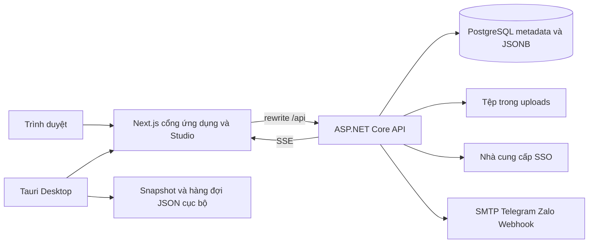
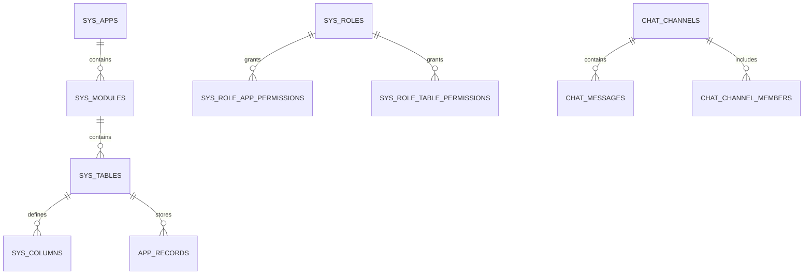
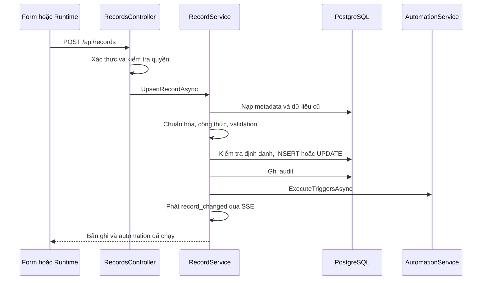

# Kiến trúc kỹ thuật SmartApps

Ngày đối chiếu mã: **17/11/2026**. Tài liệu mô tả phiên bản mã tại workspace, không khẳng định tương thích với những phiên bản dependency khác.

**Cập nhật triển khai:** xem [đợt ưu tiên 1](priority-features-implementation.md) cho contract export, chat cursor và session mới. Thời hạn token hiện đọc từ cấu hình 1–30 ngày khi đăng nhập mới; mô tả 7 ngày cố định trong khảo sát phía dưới là baseline trước thay đổi.

## 1. Mục tiêu và ranh giới

SmartApps cho phép cấu hình nhiều App doanh nghiệp trên cùng nền tảng. App chứa module, module chứa bảng; bảng và cột là metadata. Bản ghi nghiệp vụ dùng chung `app_records`, phần dữ liệu linh hoạt nằm trong `data JSONB`.

`app_id` là định danh ứng dụng. Chưa thấy mô hình tenant/công ty độc lập xuyên suốt các bảng và truy vấn. Không nên xem nhiều App là cơ chế cô lập dữ liệu nhiều khách hàng.

## 2. Sơ đồ thành phần

| Thành phần | Mã nguồn | Vai trò |
|---|---|---|
| Web | `frontend-next/src/app` | Portal, Studio, runtime, chat, tasks, settings, public form |
| Context và thư viện web | `frontend-next/src/lib` | Xác thực, phân quyền UI, cấu hình, lookup và Tauri bridge |
| API | `backend-dotnet/Controllers` | HTTP contract, nhận request và kiểm tra quyền theo từng action |
| Service | `backend-dotnet/Services` | Metadata, dữ liệu động, công thức, workflow, automation và các dịch vụ nền |
| Database khởi tạo | `db/schema.sql`, `backend-dotnet/Data/DbInitializer.cs` | DDL, cập nhật schema và seed dữ liệu |
| Desktop | `desktop-rust/src/lib.rs` | Cửa sổ App, khay hệ thống, cấu hình server, snapshot, hàng đợi |
| Tests | `backend-dotnet.Tests` | xUnit, chủ yếu kiểm thử hàm xử lý và quy tắc |

Stack khai báo: Next.js `16.1.1`, React `19.1.0`, MUI `^7.1.0`, TypeScript `^5`; backend `net9.0`, Npgsql `9.0.3`; PostgreSQL image `16-alpine`; Tauri major `2`.

### Điểm vào backend

[`Program.cs`](../../backend-dotnet/Program.cs) đăng ký các service singleton, HTTP client, controller, OpenAPI và `ScheduledReminderService`. Trước khi phục vụ request, ứng dụng gọi `DbInitializer.InitializeAsync`. Phần lớn service tạo `NpgsqlConnection` cho từng thao tác; chưa có ORM hay repository layer riêng.

Xác thực hiện được controller gọi qua `AuthService.ResolveRequestUserAsync`. `UseAuthorization()` trong pipeline không thay thế được các kiểm tra quyền thủ công này. Khi thêm endpoint phải đối chiếu đủ quyền nghiệp vụ trong action/service.

### Điểm vào frontend

[`layout.tsx`](../../frontend-next/src/app/layout.tsx) bố trí Sidebar, Navbar và nội dung. [`ThemeRegistry.tsx`](../../frontend-next/src/app/components/ThemeRegistry.tsx) cung cấp MUI/Emotion và chuỗi provider `AuthProvider → SettingsProvider → PlatformProvider`.

[`next.config.ts`](../../frontend-next/next.config.ts) chuyển `/api/*` tới backend. `/rust-api/*` trỏ tới địa chỉ engine mặc định `localhost:5300`; cây nguồn hiện khảo sát không có server Rust HTTP tương ứng. Tauri trong repo là desktop shell.

## 3. Mô hình dữ liệu

| Nhóm | Bảng chính | Ý nghĩa |
|---|---|---|
| Cấu trúc App | `sys_apps`, `sys_modules`, `sys_tables`, `sys_columns` | Cấu trúc runtime, kiểu cột, công thức, hiển thị và quyền |
| Danh mục | `sys_categories`, `sys_category_items` | Mã lựa chọn dùng chung hoặc gắn App |
| Danh tính và quyền | `sys_users`, `sys_roles`, `sys_role_app_permissions`, `sys_role_table_permissions`, `sys_revoked_tokens` | Người dùng, vai trò, phạm vi App/bảng, token đã thu hồi |
| Nghiệp vụ | `app_records`, `app_audit_logs`, `app_record_comments`, `app_attachments` | Dữ liệu động, audit, thảo luận, metadata của tệp |
| Điều phối | `app_workflows`, `app_automations`, `app_automation_logs` | Cấu hình phê duyệt và tự động hóa; workflow có DDL trong initializer |
| Trình bày | `app_widgets`, `sys_saved_views` | Dashboard và bộ lọc đã lưu |
| Cộng tác | `chat_channels`, `chat_channel_members`, `chat_messages`, `app_tasks` | Kênh, thành viên, tin nhắn và công việc |
| Cấu hình và tích hợp | `sys_user_settings`, `sys_system_settings`, `sys_api_keys`, `sys_sso_providers`, `sys_notification_channels`, `sys_notification_delivery_logs`, `sys_notifications` | Tùy chọn người dùng, kết nối và thông báo |

### Quy ước quan trọng

- `sys_columns` mô tả `column_code`, `data_type`, bắt buộc, định danh, danh mục, lookup, công thức và `hidden_for_roles`.
- `app_records` giữ `app_id`, `module_id`, `table_id`, `record_key`, `data`, `status`, lỗi validation và thông tin tạo/sửa.
- `status` chất lượng dữ liệu và `approval_status` phê duyệt là hai khái niệm khác nhau. Các hàm lưu có thể giữ bản ghi lỗi với `status = ERROR`.
- Xóa mềm dùng `deleted_at`, `deleted_by`; có API khôi phục và xóa vĩnh viễn.
- `workflow_id`, bước hiện tại và `workflow_history JSONB` nằm trên bản ghi.
- Tệp thực nằm trong thư mục `uploads`; PostgreSQL giữ metadata và đường dẫn lưu.
- Index `GIN (data jsonb_path_ops)` hỗ trợ một số kiểu truy vấn JSONB; không mặc nhiên tối ưu điều kiện `data::text ILIKE` hay mọi phép sắp xếp theo cột động.
- `idx_app_records_key` hiện là index thường. Kiểm tra trùng `record_key` trong service chưa tương đương unique constraint khi có nhiều request đồng thời.

Schema tồn tại ở cả SQL và initializer. Khi xác định cấu trúc thực tế phải xét toàn bộ DDL/ALTER trong initializer, không dùng riêng `schema.sql` làm mô tả đầy đủ.

## 4. Luồng xử lý chính

### 4.1 Đăng nhập và quyền

1. Web gửi `POST /api/auth/login`.
2. `AuthService.LoginAsync` kiểm tra tài khoản, mật khẩu và giới hạn thử đăng nhập.
3. Mật khẩu mới dùng PBKDF2-SHA256, salt ngẫu nhiên, 100.000 vòng; có hỗ trợ xác minh và nâng cấp hash cũ.
4. `CreateTokenAsync` đọc thời hạn từ cấu hình hệ thống (1–30 ngày, mặc định 7), tạo payload Base64 kèm chữ ký HMAC. Cookie dùng cùng hạn `exp` của token. Đây là định dạng riêng, không phải JWT tiêu chuẩn.
5. Controller đặt cookie `smartapps_token` HttpOnly, SameSite Lax; response cũng chứa token. Bearer được API hỗ trợ.
6. Mỗi lần resolve token sẽ xác minh chữ ký, thời hạn, bảng thu hồi rồi tải người dùng.
7. Đăng xuất đưa token vào `sys_revoked_tokens` và xóa cookie.

Quyền gồm quyền hệ thống (`studio.manage`, `user.manage`...), quyền App (`record.view`, `record.edit`...), quyền bảng, row scope `ALL`/`DEPARTMENT`/`OWNER_ONLY`, và ẩn trường theo role. Điều kiện dòng do SQL của ứng dụng thực thi, chưa phải PostgreSQL row-level security policy.

[`RecordService.OwnerFilterSqlClause`](../../backend-dotnet/Services/RecordService.cs) dùng nhiều tên trường nghiệp vụ cụ thể như `ma_nv`, `phong_ban`, `nguoi_nhan`, cùng người tạo và hồ sơ user. Khi đưa App mới vào cần kiểm tra mapping ownership; chỉ đổi nhãn cột trên UI không bảo đảm phạm vi dòng đúng.

Frontend lặp lại một phần logic quyền để bật/tắt thao tác. Backend vẫn phải là nơi quyết định quyền truy cập dữ liệu.

### 4.2 Nạp App runtime và truy vấn

Trang `/apps/[appCode]` tải cây App/module/table/column rồi tạo bảng, form, dashboard hoặc các chế độ xem. `GET /api/records` nhận App/module/table, search, status, page, limit, filters và sort.

`QueryRecordsAsync` đếm tổng trước rồi truy vấn một trang; giới hạn service từ 1 đến 500. Bộ lọc cột phân biệt kiểu chọn/boolean/lookup để so sánh chính xác, các kiểu khác có thể dùng tìm chuỗi. Controller xử lý phạm vi dòng và loại trường ẩn trong nhánh có `tableId`; cần kiểm thử cả các biến thể query thiếu tham số.

### 4.3 Lưu bản ghi thông thường

Chi tiết quan trọng từ mã:

- `AUTO_NUMBER` hiện lấy số lượng bản ghi của bảng cộng 1, ghép prefix năm/tháng.
- Công thức nội bộ qua `DynamicComputeService.EvaluateAndValidate`; công thức liên App được xử lý thêm trong `RecordService`.
- Các cột công thức hiện được tính 2 lượt, chưa phải đồ thị phụ thuộc có phát hiện chu trình.
- Bản ghi `APPROVED` được chặn sửa với người dùng không phải admin trong luồng upsert thông thường.
- Upsert ghi dữ liệu, audit rồi chạy automation; hiện chưa đặt toàn bộ chuỗi trong một transaction chung.
- Request upsert và patch chưa có expected version/ETag để phát hiện dữ liệu đã thay đổi kể từ lúc người dùng đọc.

### 4.4 Import và các đường ghi khác

`BulkImportAsync` tính công thức/validation rồi ghi các dòng trong một transaction. Nhánh cập nhật merge JSONB với dữ liệu cũ. Vòng ghi hiện không gọi lại `UpsertRecordAsync` và không có cùng chuỗi audit, auto-number, khóa bản ghi, cross-app formula và trigger của luồng thông thường.

Automation `CREATE_RECORD`/`UPDATE_RECORD` cũng ghi SQL trực tiếp. Vì vậy, cùng một thay đổi nghiệp vụ qua form, import, automation hoặc external API có thể đi qua quy tắc khác nhau. Đây là vấn đề thiết kế cần thống nhất trước khi mở rộng số loại automation.

### 4.5 Phê duyệt

`WorkflowService` lưu các bước và chọn workflow theo bảng/điều kiện. Luồng chính: `DRAFT → PENDING → APPROVED` hoặc `REJECTED`; workflow nhiều bước giữ `PENDING` khi chuyển sang bước tiếp theo. API gồm `submit-approval`, `approve` và `pending-approvals`.

`ProcessApprovalAsync` nạp bản ghi, chọn bước và kiểm tra người/role phê duyệt, cập nhật lịch sử và trạng thái. Câu UPDATE hiện lọc theo ID và chưa có phiên bản hoặc điều kiện so sánh bước cũ để chống hai người phê duyệt cùng lúc. Cần kiểm thử chuyển trạng thái, thao tác lặp và thao tác đồng thời.

### 4.6 Automation và lịch nền

`AutomationService` có cấu hình nguồn, trigger, điều kiện, action, mapping và log. Mã có các action tạo/cập nhật bản ghi, cập nhật chính bản ghi, gửi thông báo/webhook, tạo user, cập nhật trạng thái user và tạo task. Webhook ký `X-SmartApps-Signature` khi có secret, timeout 5 giây, ghi log kết quả HTTP.

Automation từ upsert chạy đồng bộ trong request. Chưa thấy hàng đợi bền vững/outbox với retry và dead-letter. `ScheduledReminderService` chờ 15 giây sau khi khởi động, rồi kiểm tra phê duyệt, công việc và trigger ngày mỗi 6 giờ. Một số tác vụ chống lặp theo ngày bằng truy vấn log/thông báo; chưa phải cơ chế khóa phân tán cho nhiều replica.

### 4.7 Chat, tasks và thông báo

`ChatService` quản lý kênh, thành viên, tin nhắn, unread, reactions/pin và liên kết công việc. `TaskService` quản lý công việc và parser lệnh `/task`, `/giaoviec`. Task có trạng thái `TODO`, `IN_PROGRESS`, `REVIEW`, `DONE`, `CANCELLED`, người giao/nhận, checklist, tiến độ và liên kết record/kênh.

`NotificationService` lưu thông báo; `ExternalNotificationService` quản lý kênh và gửi qua các adapter. Cần cấu hình credential và kiểm thử thực tế từng nhà cung cấp trước khi dùng.

`RealtimeEventService` giữ subscriber trong bộ nhớ của tiến trình; mỗi subscriber có buffer 50 event và bỏ event cũ khi đầy. SSE tại `/api/notifications/stream` có ping 25 giây. Không có replay bền vững hoặc đồng bộ event giữa nhiều instance. UI nên tải lại dữ liệu nguồn sau reconnect; không xem SSE là nhật ký dữ liệu.

### 4.8 SSO và tích hợp

SSO hỗ trợ cấu hình Google, Microsoft và custom OIDC; có state và PKCE. Pending state đang giữ trong bộ nhớ. Phần callback có đọc claim từ payload `id_token`; việc kiểm tra đầy đủ chữ ký/issuer/audience/nonce cần được hoàn thiện và kiểm chứng bằng integration test trước khi coi luồng OIDC đã được xác minh đầy đủ.

Inbound API dùng `X-Api-Key`, cấu hình tại `/api/integrations/keys`, thao tác record tại `/api/external/tables/{tableId}/records`. Khóa được service băm khi lưu. Không dùng token đăng nhập người dùng thay cho hợp đồng API key.

Public form dùng `GET /api/public/forms/{tableId}` và `POST /api/public/forms/{tableId}/submit`; chỉ khả dụng khi bảng bật `PublicFormEnabled`.

### 4.9 Blueprint và tạo App

`MetadataService` có export/import/upgrade blueprint, Excel-to-App, template catalog và `GenerateAppFromPromptAsync`. Hàm tạo App từ prompt hiện phân nhánh từ khóa để chọn cấu trúc cài sẵn; chưa thấy gọi mô hình AI bên ngoài trong luồng này.

Import blueprint cấp ID mới nhưng phần sao chép cột giữ `RefAppId`/`RefTableId` từ nguồn. Cần kiểm chứng remap lookup nội bộ và liên App; không mặc nhiên coi clone là độc lập. Chưa thấy transaction bao trùm toàn bộ quá trình tạo App nhiều bước hoặc cơ chế rollback đầy đủ.

### 4.10 Desktop và offline

Tauri cung cấp native command cho thông tin môi trường, cấu hình server, cửa sổ App, snapshot, hàng đợi và xuất tệp. Queue native là `offline_queue.json`; web có fallback `localStorage`.

Form runtime đưa yêu cầu vào queue khi nhánh lưu ném lỗi. `syncAllOfflineMutations` lần lượt gửi lại request và xóa mục khi HTTP thành công. Hiện chưa có idempotency key trên server, phân vùng queue theo user hay màn hình xử lý xung đột. Lỗi parse response hoặc lỗi xảy ra sau khi server đã ghi cũng có thể đi vào nhánh catch, vì vậy cần tránh gửi lặp tạo bản ghi.

Cấu hình Tauri đang trỏ frontend tới `http://localhost:4100`; đây là shell tải web, chưa phải một frontend đóng gói tự khởi động hoàn toàn khi mất mạng. Có native command đọc snapshot nhưng chưa thấy tích hợp tải snapshot thành runtime ngoại tuyến trong frontend đã khảo sát.

## 5. Hợp đồng API và cấu hình

Xem [api-inventory.md](api-inventory.md) để tra tất cả route khai báo trong controller. Khi backend chạy, OpenAPI ở `/openapi/v1.json`. Inventory không thay thế schema request/response hay kiểm thử quyền.

Response phổ biến là `{ success, data }`; lỗi thường là `{ success: false, message }`, nhưng action riêng và validation mặc định của ASP.NET Core có thể khác. Frontend cần kiểm tra HTTP status và shape response; nên chuẩn hóa lỗi ở giai đoạn tiếp theo.

| Cấu hình | Nơi dùng | Hiện trạng |
|---|---|---|
| `ConnectionStrings__Postgres` | API | Compose trỏ service postgres; cấu hình local có giá trị mặc định |
| `Auth__Secret` | HMAC token | Có fallback trong mã và Compose; cần bắt buộc secret riêng khi triển khai |
| `Auth__AllowDemoSwitch` | AuthController | Cho bật demo ngoài Development; cần kiểm soát theo môi trường |
| `ASPNETCORE_ENVIRONMENT` | API | Launch profile dùng Development, Compose dùng Production |
| `ASPNETCORE_URLS` | API container | Dockerfile đặt cổng 5200 |
| `NEXT_PUBLIC_API_ORIGIN` | Next rewrite | Local mặc định localhost:5200; Compose dùng backend:5200 |
| `NEXT_PUBLIC_RUST_ORIGIN` | Next rewrite | Mặc định localhost:5300; chưa có HTTP engine trong repo |
| SSO/kênh thông báo | Database và màn hình cấu hình | Cần credential thật, cấu hình redirect và kiểm thử riêng |

## 6. Quyết định kiến trúc đề xuất

Các mục sau là đề xuất, chưa phải ADR đã được chủ dự án phê duyệt:

1. Giữ backend một ứng dụng triển khai, tách module theo trách nhiệm trong nội bộ. Chưa có bằng chứng cần chuyển microservice.
2. Tập trung quy tắc ghi record vào một dịch vụ ứng dụng dùng chung cho UI, import, automation và external API; cho phép xử lý batch để không phải gọi HTTP cho từng dòng.
3. Giữ JSONB cho dữ liệu động; bổ sung constraint, sequence và index chọn lọc cho các invariant/truy vấn quan trọng.
4. Dùng migration có phiên bản thay cho mở rộng initializer không giới hạn. Chuyển seed demo sang chế độ rõ ràng.
5. Thiết kế transaction record + audit + outbox; worker gửi ra ngoài sau commit. Chấp nhận xử lý ít nhất một lần với idempotency thay vì hứa gửi đúng một lần.
6. Chỉ bổ sung shared state/broker khi thực sự chạy nhiều instance hoặc cần replay; trước đó phải ghi rõ giới hạn một instance.

Tiêu chí và thứ tự thực hiện nằm trong [development-roadmap.md](development-roadmap.md).
